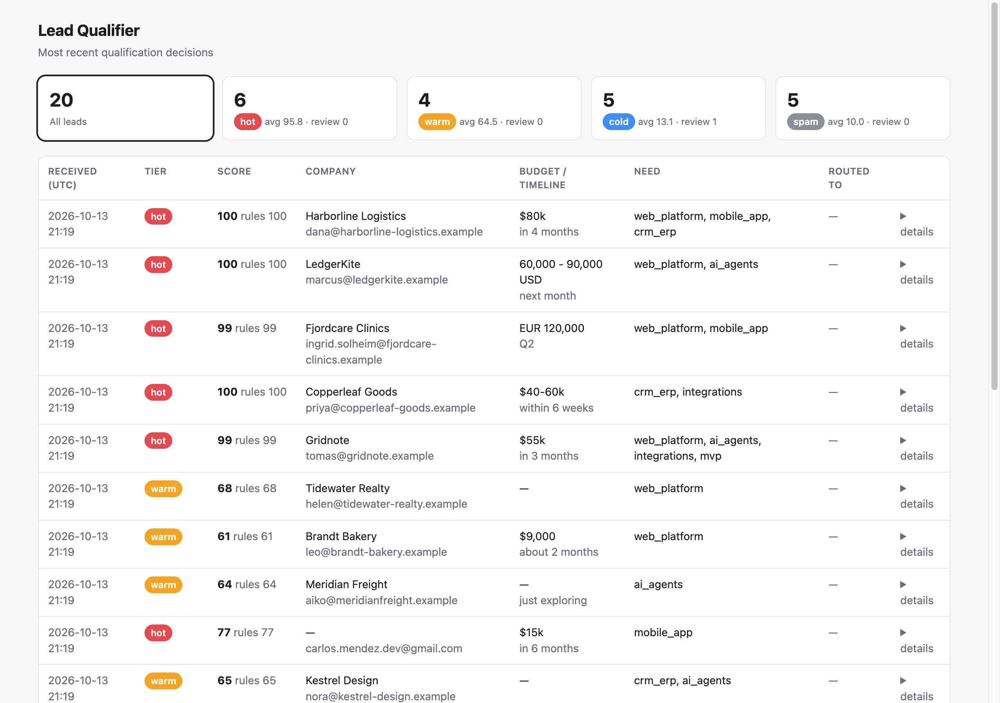
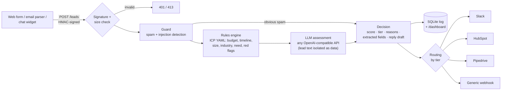

# lead-qualifier

**An AI agent that reads every inbound lead, scores it against your Ideal Customer Profile, drafts a first reply and routes it to Slack and your CRM. Rules you can audit, plus an LLM from any OpenAI-compatible provider.**

[](https://github.com/Quantum-dev1/lead-qualifier/actions/workflows/ci.yml)
[](LICENSE)


Sales teams lose hours triaging contact-form submissions. Most are vendor pitches, students or "can you build Uber for $500". The real buyers wait in the same queue.
`lead-qualifier` sits behind your forms, inbox parser or chat widget and returns for every lead:

- a **score** (0–100) and a **tier**: `hot`, `warm`, `cold` or `spam`;
- **extracted fields**: company, budget (converted to one currency), timeline in months, company size, industry, need;
- the **reasoning** behind the score: a rule-by-rule breakdown plus the model's explanation;
- a **suggested first reply**, ready for a human to review and send.

Then it posts hot leads to Slack, creates contacts, leads and notes in HubSpot or Pipedrive, and logs every decision to SQLite with a small dashboard.



## Contents

- [How it works](#how-it-works)
- [Features](#features)
- [Quick start](#quick-start)
- [Configuration](#configuration)
- [Sending leads](#sending-leads)
- [Outputs and CRM adapters](#outputs-and-crm-adapters)
- [Prompt-injection and spam defense](#prompt-injection-and-spam-defense)
- [Evaluation](#evaluation)
- [Architecture](#architecture)
- [Development](#development)
- [Roadmap](#roadmap)
- [Contributing](#contributing)
- [License](#license)

## How it works



The final score blends a deterministic rule score with the model's fit score (60/40 by default; you set the weights in YAML).
Hard rules always win over the model:

| Situation | Outcome |
| --- | --- |
| Guard spam score ≥ threshold | `spam`, no LLM call (no tokens spent) |
| Prompt-injection detected (by the guard or the model) | Model output ignored, tier capped at `cold`, `needs_review: true` |
| Disqualifying red flag (equity-only, homework, excluded industry, job seeker…) | Tier capped at `cold` |
| Lead is "just exploring" | Tier capped at `warm` |
| Model says spam but the rules score is high | Not discarded: `needs_review: true` |
| Rules and model disagree by ≥ 40 points | `needs_review: true` |
| LLM down, timing out or returning invalid JSON | Rules-only decision, reason recorded |

## Features

- **ICP in YAML.** Budget bands with currency conversion, timeline bands, company size, target industries, services you sell, red flags, spam phrases, tier thresholds, routing and reply templates. You can tune it without touching code.
- **Explainable scores.** Every decision carries a `breakdown`, e.g. `budget +30 ("$80k ≈ 80,000 USD")` or `red_flag:no_budget −35`.
- **Field extraction without the model** for budgets (`$40-60k`, `EUR 120,000`, `5k/month`, form fields), timelines (`ASAP`, `within 6 weeks`, `by March`, `Q2`, "just exploring") and company size (`120-person`, `50-200 employees`, `team of 8`). The LLM only fills the gaps.
- **No vendor lock-in.** Works with any `POST /chat/completions` endpoint: OpenAI, OpenRouter, Groq, Together, Mistral, vLLM, Ollama, LM Studio, LiteLLM. Set three env vars. With no model configured it runs rules-only.
- **Secure webhook.** HMAC-SHA256 over `timestamp.body`, a 5-minute replay window and constant-time comparison. Several secrets can be active at once for rotation. Without a secret it fails closed (503).
- **Spam and prompt-injection guard.** Lead text is untrusted and is never treated as instructions. See [below](#prompt-injection-and-spam-defense).
- **Outputs**: Slack (Block Kit), a generic signed webhook, and HubSpot and Pipedrive adapters built against their documented REST APIs. Add your own through an entry point.
- **Decision log.** SQLite (WAL) with `GET /leads`, `GET /leads/{id}` and an HTML `/dashboard`. These need `ADMIN_PASSWORD`; without it they answer localhost only.
- **Eval harness.** `lead-qualifier eval` prints accuracy, a confusion matrix and per-class precision/recall on a labelled JSONL set. Use `--min-accuracy` to gate CI.
- **Production basics**: Dockerfile (non-root user, healthcheck), docker-compose, strict mypy, ruff, 93 tests with no network access.

## Quick start

### Docker

```bash
git clone https://github.com/Quantum-dev1/lead-qualifier.git
cd lead-qualifier
cp .env.example .env          # set WEBHOOK_SECRET and ADMIN_PASSWORD, optionally LLM_* and outputs
docker compose up --build
```

### Local (with [uv](https://docs.astral.sh/uv/))

```bash
uv sync
export WEBHOOK_SECRET=dev-secret
uv run lead-qualifier serve            # http://127.0.0.1:8000, API docs at /docs

# in another terminal: send a signed sample lead
WEBHOOK_SECRET=dev-secret uv run lead-qualifier send examples/lead.json
open http://127.0.0.1:8000/dashboard   # localhost needs no password
```

You don't need a server to try it:

```bash
uv run lead-qualifier qualify examples/lead.json --no-llm
uv run lead-qualifier qualify examples/injection.json --no-llm
```

## Configuration

### Environment variables

| Variable | Default | Purpose |
| --- | --- | --- |
| `WEBHOOK_SECRET` | — | Secret(s) used to verify `X-Lead-Signature`. Comma-separated for rotation. **Required** unless `ALLOW_UNSIGNED_WEBHOOKS=true` |
| `ADMIN_PASSWORD` | — | HTTP Basic password (any username) for `/dashboard` and `GET /leads*`. Without it, only localhost is allowed |
| `LLM_BASE_URL` | `https://api.openai.com/v1` | Any OpenAI-compatible base URL |
| `LLM_API_KEY` | — | Sent as `Authorization: Bearer …` |
| `LLM_MODEL` | — | Model name. **Empty = rules-only mode** |
| `LLM_JSON_MODE` | `true` | Sends `response_format: {"type": "json_object"}`. Turn off for endpoints that reject it |
| `LLM_TIMEOUT` | `30` | Seconds |
| `SLACK_WEBHOOK_URL` | — | Slack incoming webhook |
| `OUTPUT_WEBHOOK_URL` / `OUTPUT_WEBHOOK_SECRET` | — | Generic webhook (signed like inbound when a secret is set) |
| `HUBSPOT_ACCESS_TOKEN` | — | HubSpot private app token (scopes: `crm.objects.contacts.read`, `crm.objects.contacts.write`) |
| `PIPEDRIVE_API_TOKEN` | — | Pipedrive personal API token |
| `PUBLIC_URL` | — | Base URL used for links in Slack messages |
| `ICP_PATH` / `DATABASE_PATH` | `config/icp.yaml` / `data/decisions.sqlite3` | Paths |
| `MAX_BODY_BYTES` | `64000` | Larger requests get `413` |

Examples for local models:

```bash
# Ollama
LLM_BASE_URL=http://localhost:11434/v1 LLM_MODEL=llama3.1
# OpenRouter
LLM_BASE_URL=https://openrouter.ai/api/v1 LLM_API_KEY=... LLM_MODEL=<provider/model>
```

### The ICP file

[`config/icp.yaml`](config/icp.yaml) is a complete, commented example for a software studio. An excerpt:

```yaml
weights: { rules: 0.6, llm: 0.4 }

budget:
  weight: 30
  currency: USD
  fx: { USD: 1.0, EUR: 1.08, GBP: 1.27 }
  bands:
    - { min: 50000, score: 1.0 }
    - { min: 20000, score: 0.85 }
    - { min: 8000, score: 0.5 }
  unknown_score: 0.4

red_flags:
  - id: no_budget
    description: wants work for free, equity only or revenue share only
    patterns: [equity only, no budget, unpaid, for free]
    penalty: 35
    disqualify: true

tiers: { hot: 70, warm: 45 }

routing:
  hot: [slack, hubspot, pipedrive, webhook]
  warm: [hubspot, pipedrive, webhook]
  cold: [webhook]
  spam: []
```

## Sending leads

`POST /leads` with JSON:

```json
{
  "source": "form",
  "name": "Dana Whitfield",
  "email": "dana@harborline-logistics.example",
  "company": "Harborline Logistics",
  "message": "We are a 120-person logistics company... Budget is around $80k and we want to launch in 4 months.",
  "budget": "optional free-text form field",
  "timeline": "optional",
  "company_size": "optional",
  "metadata": { "utm_source": "linkedin" }
}
```

Sign the raw body:

```text
X-Lead-Timestamp: <unix seconds>
X-Lead-Signature: sha256=<hex(HMAC_SHA256(secret, "<timestamp>." + raw_body))>
```

```python
import hashlib, hmac, json, time, httpx

body = json.dumps(lead).encode()
ts = str(int(time.time()))
sig = hmac.new(SECRET.encode(), f"{ts}.".encode() + body, hashlib.sha256).hexdigest()
httpx.post("https://leads.example.com/leads", content=body,
           headers={"content-type": "application/json", "X-Lead-Timestamp": ts, "X-Lead-Signature": f"sha256={sig}"})
```

`lead-qualifier sign body.json` prints the headers for a file, and `lead-qualifier send lead.json --url …` signs and posts it.

The response is the full decision (abridged):

```json
{
  "lead_id": "297a0963b4d5460399634c4691245730",
  "score": 100.0,
  "tier": "hot",
  "rule_score": 100.0,
  "llm_score": null,
  "needs_review": false,
  "extracted": { "company": "Harborline Logistics", "budget": "$80k", "budget_usd": 80000.0,
                 "timeline": "in 4 months", "timeline_months": 4.0, "company_size": 120,
                 "industry": "logistics", "need": "web_platform, mobile_app, crm_erp" },
  "breakdown": [ { "criterion": "budget", "points": 30.0, "detail": "$80k ≈ 80,000 USD" }, "..." ],
  "reply_draft": "Hi Dana,\n\nThanks for reaching out to Example Studio. ..."
}
```

Routing to Slack and the CRMs runs in the background after the response. Results are stored with the decision and shown on the dashboard.

## Outputs and CRM adapters

| Output | What it does | API reference |
| --- | --- | --- |
| `slack` | Block Kit message with tier, score, extracted fields, message excerpt, reasoning and reply draft. Lead text is escaped, so a lead cannot trigger `<!channel>` or inject links | [Incoming webhooks](https://docs.slack.dev/messaging/sending-messages-using-incoming-webhooks) |
| `webhook` | `{"event": "lead.qualified", "lead": …, "qualification": …}`, HMAC-signed when `OUTPUT_WEBHOOK_SECRET` is set | — |
| `hubspot` | Upserts the contact by email (`POST /crm/v3/objects/contacts/batch/upsert`, `idProperty: email`), then creates a note (`POST /crm/v3/objects/notes`) associated with association type `202` (note → contact). Per-tier contact properties are set in YAML | [Contacts](https://developers.hubspot.com/docs/api-reference/crm-contacts-v3/guide), [Notes](https://developers.hubspot.com/docs/api-reference/crm-notes-v3/guide) |
| `pipedrive` | Finds or creates the organization and the person (API v2 search + create), creates a lead (`POST /v1/leads` with value, labels and owner) and attaches an HTML note (`POST /v1/notes`, `lead_id`). Authenticates with the `x-api-token` header | [Leads](https://developers.pipedrive.com/docs/api/v1/Leads), [Persons](https://developers.pipedrive.com/docs/api/v1/Persons) |

Every adapter retries `429`/`5xx` and network errors (honouring `Retry-After`) and reports failures without raising. A broken CRM never loses a lead. The adapters were written against the vendors' documentation and published OpenAPI descriptions and are tested against mocked APIs. Run a test lead against your own sandbox account before going live.

### Writing your own adapter

```python
# my_package/outputs.py
from lead_qualifier.models import OutputResult

class TeamsOutput:
    name = "teams"
    async def send(self, lead, result) -> OutputResult:
        ...
        return OutputResult(output=self.name, ok=True)

def factory(settings, icp):
    return TeamsOutput()  # or None when not configured
```

```toml
# my_package/pyproject.toml
[project.entry-points."lead_qualifier.outputs"]
teams = "my_package.outputs:factory"
```

Then add `teams` to a tier in `routing`.

## Prompt-injection and spam defense

Anyone on the internet can write the text that reaches your model. The service assumes that text is hostile.

1. **Deterministic detection first.** Before any model call, the guard looks for spam phrases from your YAML, link floods, disposable email domains, shouting, empty messages and common injection patterns. Injection patterns include "ignore previous instructions", role switches, chat-template markup, `"tier": "hot"` style JSON steering, "mark this lead as hot" and requests to reveal the prompt. Benign phrasing such as "a CRM that scores leads as hot or cold" is covered by tests so it is **not** flagged.
2. **Isolation.** The lead is serialized to JSON and placed inside a randomly named `<lead_data_…>` block, with `<`, `>` and `&` escaped so it cannot close the block. The system prompt says the block is data and must never be followed. The model is also asked to report `injection_attempt`.
3. **Containment.** An injection attempt cannot benefit the sender. The model's score and reply are discarded, the tier is capped at `cold` and the lead is flagged for review. Spam caught by the guard never reaches the model.
4. **Output validation.** The model's JSON is parsed strictly. Scores are clamped and tiers checked against the enum. Anything malformed falls back to the rules.
5. **Escaping everywhere downstream**: Slack mrkdwn, CRM HTML notes and the dashboard.

```console
$ lead-qualifier qualify examples/injection.json --no-llm
  "tier": "cold",
  "needs_review": true,
  "reasons": [
    "Possible prompt injection in lead text (prompt-injection patterns: ignore-instructions, role-switch, score-manipulation): model output ignored for scoring, tier capped at cold, human review required.",
```

These are layered heuristics, not a guarantee. Keep a human in the loop for anything the system sends to a lead. Reply drafts are suggestions and are never sent automatically.

## Evaluation

[`evals/leads.jsonl`](evals/leads.jsonl) contains 20 synthetic, labelled leads: 5 per tier, all fictional companies on reserved `.example` domains. The set covers clear buyers, small budgets, "just exploring", equity-only offers, homework, job seekers, an excluded industry, a prompt-injection attempt, SEO pitches, outsourcing pitches and scams.

```console
$ lead-qualifier eval --today 2026-10-14
Dataset: evals/leads.jsonl (20 leads) | mode: rules only (no LLM)

Accuracy: 19/20 = 95.0%

Confusion matrix (rows = expected, columns = predicted)
expected       hot    warm    cold    spam
hot              5       0       0       0
warm             1       4       0       0
cold             0       0       5       0
spam             0       0       0       5

class       precision   recall     f1  support
hot              0.83     1.00   0.91        5
warm             1.00     0.80   0.89        5
cold             1.00     1.00   1.00        5
spam             1.00     1.00   1.00        5

Misclassified:
  warm-04: expected warm, got hot (score 77) - gmail, decent need, mid budget
```

- `--llm off` (default) runs the deterministic rules engine and guard. No network, fully reproducible. CI fails if accuracy drops below 90%.
- `--llm live` uses the model from your `LLM_*` variables. Use it to compare models and prompts on your own data.
- `--today` fixes the reference date so relative timelines ("by March") stay reproducible.
- The tests also run the eval through the LLM code path with a scripted fake model, checking that spam caught by the guard never reaches the model.

20 leads is a smoke test, not a benchmark. Replace or extend the file with your own anonymized historical leads before you trust any number.

## Architecture

```text
src/lead_qualifier/
├── app.py          # FastAPI: POST /leads, GET /leads, /dashboard, /healthz
├── cli.py          # serve | qualify | eval | send | sign
├── config.py       # env settings (pydantic-settings)
├── icp.py          # ICP YAML schema
├── extract.py      # budget / timeline / company size / keyword parsers
├── rules.py        # explainable rule score
├── guard.py        # spam + prompt-injection detection, untrusted-text isolation
├── llm.py          # OpenAI-compatible client, prompt, strict JSON parsing
├── qualifier.py    # guard → rules → LLM → decision policy
├── signature.py    # HMAC signing / verification
├── store.py        # SQLite decision log
├── dashboard.py    # dependency-free HTML dashboard
├── eval.py         # accuracy, confusion matrix, per-class metrics
└── outputs/        # slack, webhook, hubspot, pipedrive + entry-point plugins
```

Some design choices:

- **Rules first, model second.** Rules are cheap, deterministic and auditable. The model adds judgment on top. Neither can override the hard safety policy.
- **Fail closed on security, fail open on delivery.** A missing secret rejects requests. A failing CRM is logged and never loses the decision.
- **No hidden state.** Every decision, its inputs and its routing results live in one SQLite row.

## Development

```bash
uv sync
uv run pytest            # 93 tests, no network (LLM and CRM APIs are mocked)
uv run ruff check . && uv run ruff format --check .
uv run mypy              # strict
uv run lead-qualifier eval --min-accuracy 0.9
```

## Roadmap

- [ ] Email (IMAP) and chat-widget connectors that post to `/leads`
- [ ] Company enrichment step (domain → size/industry) behind a pluggable interface
- [ ] Salesforce and Zoho CRM adapters
- [ ] Async background queue with retries persisted in SQLite
- [ ] Postgres option for the decision log
- [ ] Per-tier SLAs and reminder pings in Slack
- [ ] Prompt and model A/B comparison report from `eval --llm live`

## Contributing

Pull requests are welcome. Before opening one:

1. Add or update tests (`tests/`). Network access is not allowed in tests: use `httpx.MockTransport` or the `ScriptedLLM` fake.
2. Run `ruff`, `mypy` and `pytest`.
3. If you change scoring, run `lead-qualifier eval` and include the before/after report in the PR.

## License

[MIT](LICENSE) © Quantum Dev

---

Built by [Quantum Dev](https://quantumdevteam.com) — we build web platforms, mobile apps and AI agents. Need something like this for your business? [Book a call](https://cal.com/aleksandr-ganus/30m).
